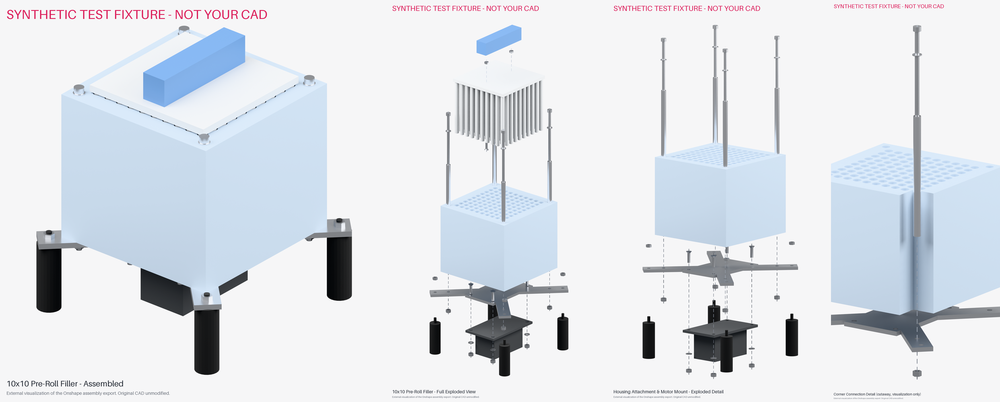

# Pre-Roll Filler: Exploded Views (offline Blender pipeline)

This turns an export of the Onshape assembly for the 10×10 pre-roll filling machine into:

| Output | File |
|---|---|
| Assembled isometric render | `out/assembled_isometric.png` |
| Full exploded isometric render | `out/full_exploded_isometric.png` |
| Housing attachment / motor mount exploded detail | `out/motor_mount_exploded.png` |
| Corner fastener cutaway detail | `out/corner_fastener_detail.png` |
| Editable Blender project (one keyframe per view, a camera bound to each) | `out/preroll_exploded_views.blend` |
| Component manifest + explosion transforms | `out/manifest.json` |
| BOM | `out/bom.csv`, `out/bom.md` |
| Verification report | `out/report.md`, `out/verification.json` |

The renders are **external visualizations**. The pipeline never writes to Onshape, so the
original parts, mates and assembly stay exactly as they are.


*The image above comes from a **synthetic test fixture** (`tests/make_test_fixture.py`), a rough
stand-in built from the nominal dimensions in the brief. It is **not** the real CAD. It's only here
to show the pipeline working end to end.*

## 1. Get the geometry (0 to ~7 Onshape API calls)

**Option A: zero API calls (recommended).** In Onshape, right-click the assembly tab →
**Export** → format **GLTF** (binary `.glb`). Save it as `cache/assembly.glb`.

**Option B: REST API, once, then cached.**
```bash
export ONSHAPE_ACCESS_KEY=...   # from https://dev-portal.onshape.com/keys
export ONSHAPE_SECRET_KEY=...
python3 scripts/onshape_fetch.py "https://cad.onshape.com/documents/9fbac953243f31967159b179/w/c8db81fd540f512bf34af8ab/e/3d08bd44a47321176a23eca2" --out cache/
```
This makes one assembly-definition GET, one BOM GET and one GLTF translation POST (`storeInDocument=false`,
so nothing is added to the document), then polls and downloads. Each step is skipped if its file is already
cached, and every request is logged to `cache/api_log.json`. *This script follows the public API reference but
hasn't been run against the real document yet (see "Status").*

## 2. Install Blender's Python module
```bash
pip install bpy==5.2.3 numpy pillow     # needs Python 3.13
```
(Or run the same script inside any Blender 4.2+ install: `blender -b -P scripts/build_views.py -- --glb …`.)

## 3. Check the classification first (no rendering)
```bash
python3 scripts/build_views.py --glb cache/assembly.glb --dump-names
```
Every instance is printed with its group, centre, size and the rule that matched. Parts are classified
by **name keywords** (`config/explode_config.json → classification.keyword_rules`), then hardware is
resolved **by position**:

* a screw ≥ 60 mm long becomes a *housing bolt*; its XY position defines a corner axis
* a washer or nut on a corner axis is *upper* if it's above the housing mid-height, otherwise *lower*
* a nut or screw above the housing top is *handle* hardware; one on a foot axis is *foot* hardware; anything else is *motor* hardware

If a CAD name doesn't match, add a regex to `classification.overrides`, e.g.
`{"^Part 7 ": "bracket"}`. Unmatched parts land in `unassigned` and get a magenta material,
so nothing is silently dropped.

## 4. Build everything
```bash
python3 scripts/build_views.py --glb cache/assembly.glb --assembly-json cache/assembly_definition.json --bom-json cache/bom.json --out out/
```
On a 4-core CPU this takes about 5–6 minutes at 2400 px and 96 samples. For quick iteration add
`--long-edge 900 --samples 16` (≈20 s), or `--no-render` to run only the checks, manifest and .blend.

## How the explosion is computed
* The housing is fixed. Every group moves **only along +Z/−Z**, so bolts, sleeves, washers and nuts stay on
  their axes, the tamper pins stay over their cavities, and the motor stays centred on the bracket.
  Part orientations are never changed.
* The starting offsets are the brief's table (`groups.*.z`, in mm). A collision solver then
  1. applies `solver.must_clear` rules. The default moves the **handle screws below the tamper pin tips**,
     because with the brief's +210 / +240 values the screws would end up buried among the 100 pins;
  2. keeps any parts that were stacked in the assembly (disjoint Z ranges) in the same order, with at least `min_gap_mm` between them;
  3. checks interpenetrating pairs (bolt through sleeve, pins in cavities, and so on) for true mesh intersection
     with BVH trees, and pushes the outer group outward in 5 mm steps until they're clear.
  Every adjustment is logged in `manifest.json → solver_moves`.
* The captive handle nuts are shown at +270, between the tamper plate and the handle, because at +300 they'd
  sit invisibly inside the handle.
* The views (`config → views`) have their own offsets, hidden groups, camera azimuth/elevation and guide-line groups.
  The corner detail uses a **non-destructive boolean on a copy** of the housing to cut away one corner.

## Automated checks (`out/report.md`)
Inventory against the expected counts; unclassified parts; housing height ≈128.5 mm; bracket thickness ≈4.75 mm;
motor envelope ≈110×66×48 and centred on the bracket; each bolt coaxial with its sleeve, washer and locknut (<0.5 mm);
**ray-cast hole checks** confirming the bracket hole and housing channel are open on every bolt axis and the bracket holes
under each motor screw; tamper pins over open cavities; intersections remaining after explosion; per-view
visibility (each group must have at least one clearly visible instance); materials per group; and a list of
assembled-state contacts/interferences (for information only).

## Status (run on the real export, `Pre-Roll Filler Assembly.gltf`)
* **The deliverables in `out/` were built from the real Onshape glTF export.** It was exported by hand from the
  Onshape UI, so the pipeline made **0 Onshape API calls**. Its only Onshape traffic was 2 failed requests in the
  authoring session (one blocked by the network, one refused with 403 because no key was supplied).
* **Native Onshape exploded views were not created.** A supported create endpoint couldn't be verified (no MCP and
  no API key were available in the authoring session). These are external visualizations; the Onshape document,
  parts and mates are unchanged.
* The export's "up" direction is −Y, so `config.up_axis = "-Y"` applies one rigid rotation to the whole assembly.
* 24 of the 37 instances are named just "Part 1", so they're classified by size signature (`classification.geometry_rules`).

### CAD findings worth reviewing (details in `out/report.md`)
| # | Finding | Evidence |
|---|---|---|
| 1 | **The motor screws are M5 (Ø5.0 shank, Ø10 countersunk head), but they mate with M4 nuts** ("Prevailing torque nut thin M4x0.70", Ø3.24 bore) | 4 screw/nut interferences of 0.88 mm radial |
| 2 | **The M4 handle screws end 4.7 mm short of the captive M4 nuts** (screw top z = 97.2, nut bottom z = 101.9) | They never engage; consider M4×16–18, or moving the nuts down |
| 3 | The housing is **135.0 mm** tall, not 128.5 mm (the sleeves are 128.5 mm; the bolt heads sit in 6.5 mm counterbores) | bbox |
| 4 | The X-bracket ("Motor Mount") is modelled at **5.00 mm**, not 4.75 mm (0.187" sheet) | bbox |
| 5 | **No motor washers** in the CAD; the motor uses 4 screws + 4 nuts. **The rubber feet thread onto the ends of the 200 mm housing bolts**; there's no separate foot hardware | inventory |
| 6 | Everything else checks out: all 4 bolt stacks (bolt, washer, sleeve, nut, foot) are coaxial to 0.00 mm; the bracket holes and housing channels are open on every axis; the motor is centred on the bracket; all 100 tamper pins sit over open cavities | ray-cast checks |
